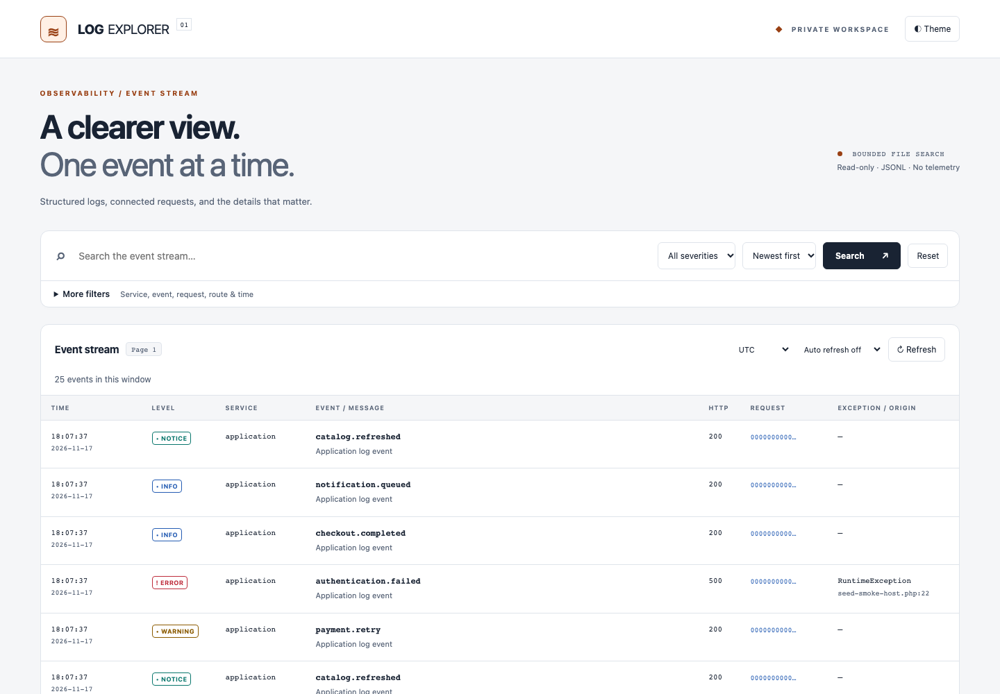
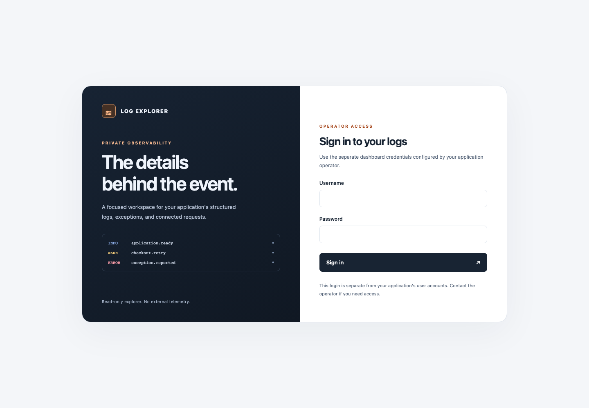

# Laravel Logger

Structured JSON logs and a **built-in Blade log explorer**, with its own username
and password. Inspect exceptions, follow request IDs, and search recent events
without adding a log database or building frontend assets in your application.

[](https://packagist.org/packages/fiachehr/laravel-logger)
[](https://github.com/fiachehr/laravel-logger/actions/workflows/ci.yml)
[](LICENSE)

**Where is the panel?** Open **`<your application URL>/log-explorer`** after setup.
For example: **http://127.0.0.1:8000/log-explorer**. You will be taken to the
package's own sign-in page. [Configure the dashboard login](#3-configure-the-built-in-login).



## Contents

- [Features](#features)
- [Requirements](#requirements)
- [Installation and first login](#installation-and-first-login)
- [Using the log explorer](#using-the-log-explorer)
- [Logging and exceptions](#logging-and-exceptions)
- [Request and queue correlation](#request-and-queue-correlation)
- [Using your application's login instead](#using-your-applications-login-instead)
- [Safe diagnostic helpers](#safe-diagnostic-helpers)
- [Configuration and privacy](#configuration-and-privacy)
- [Troubleshooting](#troubleshooting)
- [Documentation](#documentation)
- [Development and tests](#development-and-tests)
- [Upgrading from 0.1](#upgrading-from-01)
- [Contributing](#contributing)
- [Security](#security)
- [License](#license)
- [Author](#author)
- [FAQ](#faq)

## Features

- **Built-in interface:** Blade pages, bundled CSS/JavaScript, responsive table,
  light/dark themes, keyboard navigation and accessible detail tabs. No CDN,
  mandatory asset publishing, separate frontend application, or host Node build.
- **Independent login:** one separately configured operator account, hashed password,
  CSRF protection, sign-out, session rotation, idle/absolute expiry, credential
  rotation invalidation, and limits on sign-in attempts. No user table or migrations.
- **Optional host authentication:** use an existing Laravel guard and explicit Gate
  instead of the separate credentials when that suits your application.
- **Laravel-native logging:** opt-in Monolog 3 channel for existing `Log::*` calls,
  exception origin/line, bounded traces and request/queue correlation.
- **Focused exploration:** literal search, severity/service/event/time/request/route/
  exception/status filters, snapshot pagination, JSON/raw views and copy controls.
- **Bounded local storage:** private daily JSONL files, retention, locked writes,
  daily size quota and limited search windows. No external log service is required.
- **Privacy defaults:** metadata allowlists, categorical messages, secret filtering,
  bounded diagnostics, no automatic request bodies or arbitrary object serialization.

Logging and the dashboard are **disabled on installation**. Enable them explicitly.
The explorer is read-only; its POST endpoints only sign the operator in and out.
No external telemetry is sent.

## Requirements

| Component          | Supported range                                        |
| ------------------ | ------------------------------------------------------ |
| PHP                | 8.3, 8.4 or 8.5, with JSON and mbstring                |
| Laravel            | 12.x or 13.x                                           |
| Monolog            | 3.x                                                    |
| Local filesystem   | Linux or macOS; private writable storage               |
| Dashboard sessions | Laravel `web` session middleware and a valid `APP_KEY` |

The CI matrix covers all six PHP/Laravel combinations. See the
[validation record](docs/validation.md) for executed checks and runtime limits.
The dashboard uses Laravel's existing session and cache infrastructure: file-based
sessions/cache can be used when no database or Redis is desired. Review a session
driver change for the whole host app rather than changing it just for this package.

## Installation and first login

### 1. Install the package

```bash
composer require fiachehr/laravel-logger:^0.2
php artisan log-explorer:install
```

Laravel auto-discovers the provider. The installer asks before publishing a missing
`config/log-explorer.php`, preserves an existing file, and prints the remaining
opt-in steps. It does not edit `.env`, logging channels, users or authorization.
For noninteractive configuration publishing:

```bash
php artisan vendor:publish --tag=log-explorer-config
```

If a new tag has not reached Packagist yet, use the GitHub repository directly:

```bash
composer config repositories.laravel-logger vcs https://github.com/fiachehr/laravel-logger
composer require fiachehr/laravel-logger:^0.2
```

Run Composer and Artisan in the application's actual runtime. With Docker, run
them inside the PHP service; a PHP-FPM service port is not an HTTP dashboard port.

### 2. Connect Laravel logging

Add this entry inside `channels` in `config/logging.php`:

```php
'observability' => [
    'driver' => 'custom',
    'via' => \Fiachehr\LaravelLogger\Logging\CreateLogger::class,
    'level' => env('LOG_EXPLORER_LEVEL', 'debug'),
],
```

For application-wide structured logging, set:

```dotenv
LOG_EXPLORER_ENABLED=true
LOG_EXPLORER_SERVICE=application
LOG_CHANNEL=observability
```

To keep existing outputs, include `observability` **once** in your existing stack
and keep `LOG_CHANNEL=stack`. For example, a stack's `channels` may be
`['single', 'observability']`. Each destination still has its own privacy behavior;
this package does not sanitize a copy written to `single`, `daily`, or another logger.

### 3. Configure the built-in login

Generate a password hash with a hidden terminal prompt:

```bash
php artisan log-explorer:password
```

Enter and confirm a strong password of 12–72 bytes. The command prints a line such
as `LOG_EXPLORER_PASSWORD_HASH='...'`; copy the **entire generated line**, including
its single quotes, into your private `.env`. The actual password is not printed,
passed as a command argument, or written into a file by the command.

Then configure:

```dotenv
LOG_EXPLORER_DASHBOARD_ENABLED=true
LOG_EXPLORER_AUTH_MODE=credentials
LOG_EXPLORER_USERNAME=log-operator
# Paste the LOG_EXPLORER_PASSWORD_HASH='...' line generated by the command here.
```

`credentials` is the default for fresh 0.2 configurations. There is **no default
password**, registration page, password reset endpoint or application-user lookup.
Both username and a supported password hash are required; missing/invalid
credentials fail closed with HTTP 503. Never store a plaintext password in this setting.

Keep `dashboard.middleware` as `['web']` for this mode. An extra host `auth` or
admin middleware would also require the application's login. This includes custom auth checks added to the host's `web` group. Choose
a suitable session middleware group for the explorer if your app customizes it.
No host Gate is needed for independent credentials mode.

Apply configuration changes in your application runtime:

```bash
php artisan config:clear
php artisan route:clear
```

Rebuild deployment caches and restart long-running workers as part of your normal
production release process. Use HTTPS and secure session cookies for remote access.

### 4. Open the panel

Start your application's normal web server, then visit its URL with `/log-explorer`:

| Your running application | Dashboard                            |
| ------------------------ | ------------------------------------ |
| `http://127.0.0.1:8000`  | `http://127.0.0.1:8000/log-explorer` |
| `http://my-app.test`     | `http://my-app.test/log-explorer`    |
| `https://example.com`    | `https://example.com/log-explorer`   |

The panel redirects to **`/log-explorer/login`**. Enter the separate username and
**original password** you configured, not the hash. You do not need to sign in to
your application's regular user panel first. Select **Sign out** in the explorer
to end its session; the host application's login and other session data are kept.
The two logins share Laravel's session infrastructure, with separate authentication state.



For an optional, dedicated **local development** port:

```bash
php artisan log-explorer:serve --port=8765
```

Open **http://127.0.0.1:8765/log-explorer** and sign in there. The command requires
`APP_ENV=local` or `development`, binds `127.0.0.1`, and serves the whole host app
in the foreground. It does not start automatically. Production uses an
operator-managed web server/reverse proxy; see [deployment examples](docs/deployment.md).

To change the path, set `LOG_EXPLORER_PATH=internal/logs`, clear/rebuild route and
config caches, and open `/internal/logs`. Login/logout/assets move with that prefix.

### 5. Write your first event

Use a normal application code path:

```php
use Illuminate\Support\Facades\Log;

Log::info('Application ready', ['event' => 'application.ready', 'count' => 1]);
```

For a quick terminal check **if your application includes Laravel Tinker**:

```bash
php artisan tinker --execute="Log::channel('observability')->info('Explorer ready', ['event' => 'application.ready']);"
php artisan log-explorer:doctor
```

Refresh the explorer. Daily files are created on the first write at
`storage/logs/log-explorer/events-YYYY-MM-DD.jsonl`. The explorer reads this package's
structured files; it does not import old `laravel.log` files. `doctor` checks
configuration, credentials or Gate, storage and assets without printing secrets;
it does not replace a real browser login test.

## Using the log explorer

1. Search by a literal term, select a severity/order, or open **More filters** for
   service, event, request ID, exception class, route name, HTTP status and UTC dates.
2. Select an event to open **Overview**, **Exception**, **Context**, **JSON** or
   **Raw**. Raw means the stored sanitized JSON line, never pre-sanitization input.
3. Use **Show this request** or a table request ID to group events with that ID.
   This is correlation within the configured source, not distributed tracing.
4. Choose UTC/local time, switch theme, copy sanitized JSON, or enable auto refresh.
   Polling pauses while a detail panel is open or the tab is hidden.
5. **Next window** continues a bounded search. A window may have no matches even
   when older files contain matches. There is no unbounded archive total.

Newest/oldest sorting follows file append order. Refresh starts a new snapshot;
cursors expire after 15 minutes. The independent login expires after 30 idle
minutes or eight hours total by default. Changing its username/password hash
invalidates existing dashboard sessions on their next request.

## Logging and exceptions

Existing `Log::debug/info/warning/error/critical` calls work once routed to the
channel. Use fixed developer-controlled identifiers so events remain useful with
privacy defaults:

```php
Log::warning('Checkout retry', ['event' => 'checkout.retry', 'count' => 2]);
Log::error('Checkout failed', ['event' => 'checkout.failed', 'exception' => $exception]);
```

Laravel-reported exceptions reach the configured default channel automatically;
no second exception reporter is installed. For a caught exception, use
`report($exception)` **or** one explicit log call containing the Throwable under
`exception`. A message-only call such as `Log::error($exception->getMessage())`
cannot retain its exception origin/trace. Avoid logging and reporting the same
failure twice. Laravel's own ignored-exception policy remains in effect.

Messages default to `Application log event`. The event identifier, exception type,
origin and trace carry the diagnostic information. Do not put user input or secrets
in identifiers. Direct Monolog instances, other channels and external transports
are covered only when explicitly routed here.

## Request and queue correlation

For Laravel's `bootstrap/app.php` configuration, add the following inside your
existing `withMiddleware` callback, importing the package middleware:

```php
use Fiachehr\LaravelLogger\Http\CorrelateRequest;

$middleware->web(prepend: [CorrelateRequest::class]);
$middleware->api(prepend: [CorrelateRequest::class]);
```

For apps retaining `app/Http/Kernel.php`, prepend the same class to the `web`/`api`
route middleware groups. Register it once per group, after the router has matched
a route; global pre-routing middleware cannot reliably capture route metadata.

Captured HTTP metadata includes method, route name/template and a generated ID,
not actual route values, query strings, IPs, headers or bodies. Incoming IDs are
ignored unless explicitly trusted behind an edge that strips/replaces client IDs.
Queue class/attempt metadata and scoped cleanup use Laravel worker lifecycle events;
job payloads are not logged. See [validation limits](docs/validation.md) for Octane.

## Using your application's login instead

Set `LOG_EXPLORER_AUTH_MODE=host` in a configuration that includes the new `auth`
block. Define the Gate in your application's provider, adapting the model/policy:

```php
use App\Models\User;
use Illuminate\Support\Facades\Gate;

// Inside the provider's boot() method:
Gate::define('viewLogExplorer', fn (User $user): bool => (bool) $user->is_log_operator);
```

`is_log_operator` is an example host-owned boolean, not a field created by this
package. Replace it with your actual permission policy. Select `dashboard.guard`
if needed and retain the host's appropriate middleware. An existing `Gate::before`
can grant abilities; add a direct role/admin middleware too if your policy requires
an exact role independently of those grants.

Sign in through the application's normal login page on the same origin, then open
`/log-explorer`. In host mode, anonymous access returns 401, a missing/denied Gate
returns 403, and the independent login routes are unavailable. Both modes protect
the explorer, JSON API and dashboard assets; only the credentials login page and
its static stylesheet are accessible before independent sign-in.

## Safe diagnostic helpers

Enable `diagnostics.enabled` explicitly in `config/log-explorer.php` before use:

```php
use function Fiachehr\LaravelLogger\log_dump;

log_dump($value, 'checkout.state'); // records a bounded type/count summary and continues
```

Approved array fields can be included in `safe` payload mode. Arbitrary objects,
models and request graphs are never dumped. The namespaced `log_dd` helper is
rejected with `LogicException` unless logging, diagnostics and `allow_stop` are
explicitly enabled in `local`/`development`; it then logs and throws an HTTP 500
exception to unwind execution. Native `dump()`/`dd()` are unchanged. See the
[security policy](docs/security.md) before enabling diagnostics.

## Configuration and privacy

The publishable [configuration file](config/log-explorer.php) contains all options.

| Setting                           | Default                                      |
| --------------------------------- | -------------------------------------------- |
| Logging / dashboard / diagnostics | Disabled                                     |
| Authentication                    | Independent credentials; no default password |
| Payload / message mode            | `metadata` / `categorical`                   |
| Context depth / items / string    | 5 levels / 30 items / 1,000 bytes            |
| Exception frames / previous depth | 15 / 2                                       |
| Event / daily file cap            | 16 KiB / 64 MiB                              |
| Retention / searchable files      | 14 days / up to 14 daily files               |
| Per-request search budget         | 8 MiB / 250 ms / 50 results                  |
| Dashboard requests                | 60/minute per authorized identity            |
| Login attempts                    | 5/IP and 20/account per 60 seconds           |
| Independent session               | 30 idle minutes / 8 hours maximum            |

`none` drops user context; `metadata` allows operational fields; `safe` adds
explicitly approved fields. Sensitive-key protection applies in every mode.
Free-text `message_mode=redacted` is an opt-in defense in depth: regex cannot
reliably remove arbitrary secrets or personal data. Prefer categorical production
messages and review every approved field.

Keep storage canonical, private and outside the web root. New directory/files use
0700/0600; symlinks/hardlinks are rejected. A daily file at its quota rejects new
writes with a constant stderr warning. Retention runs on writes; idle installations
may need operator-managed expiry. Login and API rate limits use the host cache;
use a persistent shared cache across workers. Review trusted proxies, HTTPS,
Secure/HttpOnly/SameSite cookies and private configuration-cache permissions.

The independent login also stores revocation tokens in that cache. Use a persistent
driver such as `file` for one server or an appropriate shared driver for multiple
servers; `array`/`null` do not preserve logins across requests. Clearing this cache
signs dashboard operators out. Logout revokes the token so replaying an old session
does not restore access, even when concurrent requests still hold old session data.

## Troubleshooting

| Symptom              | What to check                                                                                                                 |
| -------------------- | ----------------------------------------------------------------------------------------------------------------------------- |
| Cannot connect       | Start the host web server; confirm hostname and published HTTP port. Installing a package does not start a server.            |
| 404                  | Both enable flags, custom prefix and cached routes/config.                                                                    |
| 503 on login         | Username, supported password **hash**, authentication mode, `web` session middleware and config cache.                        |
| Invalid credentials  | Use the original password, not its hash; verify the username and quoted environment hash.                                     |
| 419                  | Reload the login page for a fresh CSRF token; check session storage, cookies and origin.                                      |
| 401 on API/assets    | Sign in again; independent sessions can expire or be invalidated by credential rotation.                                      |
| 403 in host mode     | Guard login, the configured Gate, and any role/admin middleware.                                                              |
| 429                  | Pause polling/sign-in attempts, wait for `Retry-After`, and check the shared cache configuration.                             |
| Empty table          | Generate a new event through the structured channel; check level, filters, daily quota and storage permissions with `doctor`. |
| Generic message text | This is the default categorical privacy policy; use fixed event codes and attach the Throwable.                               |

## Documentation

- [Architecture](docs/architecture.md) · [JSON schema and LogSource extension](docs/schema.md)
- [Security and threat model](docs/security.md) · [Deployment and dedicated port](docs/deployment.md)
- [Upgrade, rollback and uninstall](docs/lifecycle.md) · [Release procedure](docs/releasing.md)
- [Performance measurements](docs/performance.md) · [Validation record](docs/validation.md)

## Development and tests

```bash
composer install
composer check
composer audit
npm ci
npx playwright install chromium
```

Create disposable hosts in **new** directories, never a real application:

```bash
tools/create-smoke-host.sh /absolute/new-host
LOG_EXPLORER_SMOKE_AUTH=credentials tools/create-smoke-host.sh /absolute/new-credentials-host
php /absolute/new-host/artisan log-explorer:serve --port=18765
php /absolute/new-credentials-host/artisan log-explorer:serve --port=18767
# From another terminal:
npm test
```

Smoke credentials are synthetic test data, not production defaults. Tests cover
both host login and the built-in login on real Laravel hosts with cached routes/
config. Browser checks include CSRF, unauthorized access, filters, details,
clipboard, mobile layouts, stored XSS fixtures and automated axe checks. Screenshots
are actual captures. Reproduce file-reader measurements with
`php tools/benchmark.php /absolute/new-host`.

## Upgrading from 0.1

Version 0.2 adds independent credentials and defaults **fresh configurations** to
that mode. Existing published 0.1 configurations without `dashboard.auth` retain
their host-login behavior. To choose a mode explicitly, merge the new `auth` block
from the package configuration into your published file; do not blindly overwrite
host settings. Set `mode` through `LOG_EXPLORER_AUTH_MODE`, configure credentials
or the host Gate, rebuild caches, and restart workers. The JSON schema remains 1.0.

## Contributing

Contributions are welcome. Read [CONTRIBUTING.md](CONTRIBUTING.md), use synthetic
data, include meaningful regression coverage, and update documentation and the
[CHANGELOG](CHANGELOG.md). Follow the [code of conduct](CODE_OF_CONDUCT.md).

## Security

Report vulnerabilities privately as described in [SECURITY.md](SECURITY.md).
Do not post production logs, credentials or exploit details in public issues.
Review the [threat model and production checklist](docs/security.md) before deployment.

## License

This package is open-source software licensed under the **MIT license**.
See [LICENSE](LICENSE) for details.

## Author

**Fiachehr**

- GitHub: [@fiachehr](https://github.com/fiachehr)
- Email: [mailbox@fiachehr.ir](mailto:mailbox@fiachehr.ir)

## Acknowledgments

- The Laravel and Monolog communities
- Open-source maintainers and security researchers
- Everyone contributing feedback, fixes and documentation

## Useful Links

- [Laravel documentation](https://laravel.com/docs)
- [Monolog](https://github.com/Seldaek/monolog)
- [Package on Packagist](https://packagist.org/packages/fiachehr/laravel-logger)
- [Issues and feature requests](https://github.com/fiachehr/laravel-logger/issues)

## FAQ

### Does the dashboard need Vue, a separate frontend or a build step?

No. Blade pages and their CSS/JavaScript ship inside the Composer package.
The host application does not need to install Node dependencies or publish assets.

### Can I use a different username and password from my application's users?

Yes. The default fresh configuration uses `credentials` mode with its own account.
It needs no application user, role or Gate. The optional `host` mode uses your
existing guard/Gate instead; the two modes are explicit alternatives.

### Can I open it on port 8765?

For local development, run `php artisan log-explorer:serve --port=8765` and visit
`http://127.0.0.1:8765/log-explorer`. In production, configure the listener in your
web server/reverse proxy. A port alone never grants dashboard access.

### Will it display every old log or intercept native dump calls?

It displays its configured structured source. Existing text logs, unrelated logger
transports and native `dump()`/`dd()` calls are not automatically converted.

---

<div align="center">

**If you find this package useful, give it a ⭐️!**

Made by Fiachehr with ❤️ for Laravel

</div>
