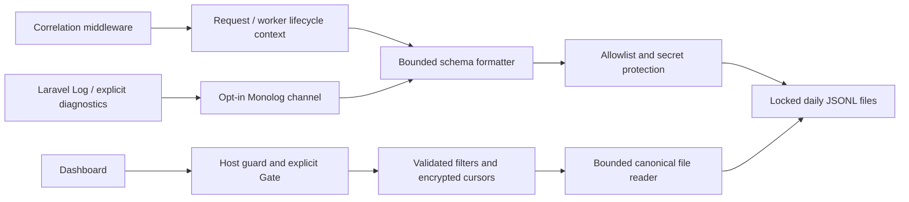

# Architecture and acceptance plan

Repository audit (2026-11-17): empty Git repository, origin fiachehr/laravel-logger,
PHP CLI 8.4.5, Composer 2.8.6, Node 22.14.0; Docker daemon unavailable.
There is no existing host application, framework, logger, or frontend to preserve.

## Decisions

Use the existing repository identity fiachehr/laravel-logger and MIT license, approved by the maintainer.
GitHub connector confirmed the repository is public and owned by fiachehr.
Target PHP 8.3–8.5, Laravel 12/13, Monolog 3, Testbench 10/11. Distinguish configured
CI coverage from actually executed tests in validation.md. Do not claim future PHP majors.
Sources: https://laravel.com/docs/13.x/releases and https://www.php.net/supported-versions.php.

No database, CDN, Node build, outbound requests, source-code browser, downloads,
deletion endpoint, automatic exception reporter, or native dump interception.
The package channel captures records routed to it, including framework-reported
exceptions. Stacks opt in manually. Never register another exception reporter:
Laravel's existing reporting policy decides which exceptions are recorded.

Use categorical messages by default, trusted metadata only, no auth model loads.
Middleware metadata lives on the current Request. Queue metadata uses scoped
storage plus explicit worker reset events. No singleton captures scoped context.
Read pages have byte/time/file/result limits and opaque, expiring snapshot cursors.
Ordering is append order (newest or oldest), not arbitrary timestamp sorting.
Fixed assets are served through authorized routes and require no vendor publish.
Plain DOM rendering makes hostile text inert and keeps distribution simple;
the tradeoff is a small hand-maintained interface rather than a frontend framework.

## Phases / acceptance

1. Architecture: audit, version targets, threat model, explicit defaults.
2. Core: privacy policy, JSON schema, channel, HTTP/queue isolation; canary tests.
3. Storage: canonical files, rotation, partial records, bounded cursor search.
4. Dashboard: Gate + guard on every endpoint, accessible table and detail views,
   filters, theme, clipboard, grouping; browser and adversarial tests.
5. Diagnostics / port: explicit helpers; stop restricted to development;
   loopback-only optional launch using host Laravel middleware.
6. Release: test both framework versions, static analysis, audit, benchmark,
   clean-host Composer installation, docs, semver tag, authorized push.

The v0.1.0 initial release is intentionally pre-1.0 while public API usage matures.
Production safety depends on host authentication, OS permissions, retention and
operator approval of every extra diagnostic field. Threats are in security.md.
